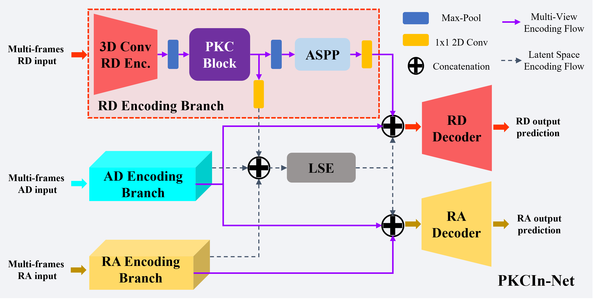
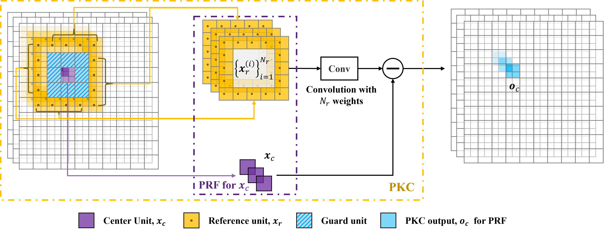
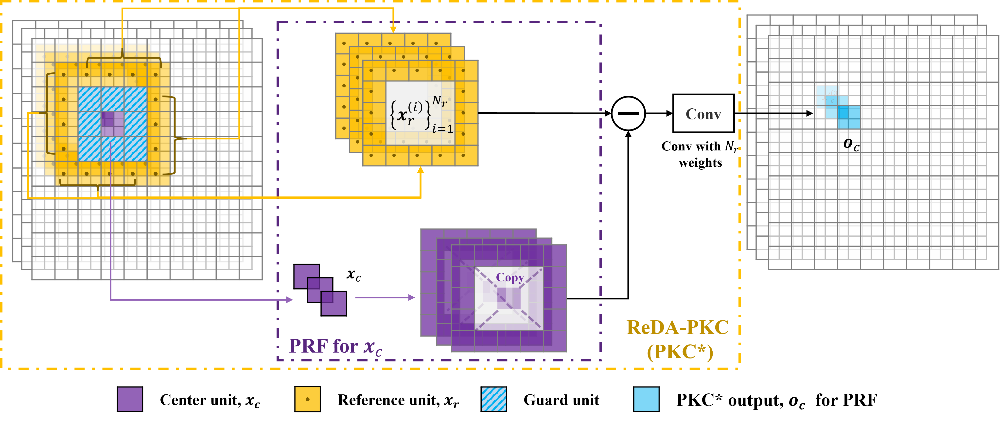
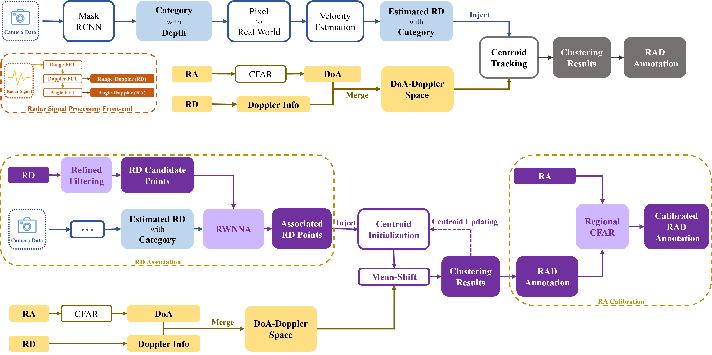

# PeCoRSS: Awsome Radar Semantic Segmentation Library developed by PeCoLab of ISTA@CASIC

- Contributers of PeCoLab
  - Liwen Zhang [Liwen Git.](https://github.com/zlw9161)
  - Youcheng Zhang
  - Xinyan Zhang
  - Teng Li
  - Zijun Hu
  - Etc.
- Recommend Environment
  - Python 3.9.19
  - Torch 2.1.0
  - Numpy 1.26.4

## Illustrations of RSS-Nets

### TARSS-Net


> TARSS-Net: Temporal-Aware Radar Semantic Segmentation Network, under submission of NeurIPS 2024.

### PKCIn-Net







> PeakConv: Learning Peak Receptive Field for Radar Semantic Segmentation, CVPR2023.
> [PeakConv Code Link](https://github.com/zlw9161/PKC)

## Illustrations of Radar DataSets

### CARRADA-RAC V.S. CARRADA


[CARRADA_RAC Link](https://github.com/zlw9161/CARRADA-RAC)

[CARRADA Link](https://github.com/valeoai/carrada_dataset)



> CARRADA_RAC Pipline is used for correct the annotations of CARRADA

## Model-Data Support

### Single-View Support

| DataSet    | Model          | Description              | Task Type    |
| ---------- | -------------- | ------------------------ | ------------ |
| KuRALS-CWR | CWRNet         | Default baseline model.  | sv (RD only) |
|            | PKCIn4CWR      | PKCIn ReDA version       |              |
|            | PKCIn4CWR_Dns  | PKCIn Vanilla version    |              |
|            | TARSS4CWR_V1   | TARSS-Net w/ Depth-TRAP  |              |
|            | TARSS4CWR_V2   | TARSS-Net w/ Spatio-TRAP |              |
|            | Unet           |                          |              |
|            | FCN8s          |                          |              |
|            | DeepLabV3Plus  | DeepLabV3+ w/ ResNet101  |              |
|            | AdaPKC         | To be merged             |              |
|            | TFoc           | To be merged             |              |
|            | KuRadNet       | Default baseline model.  | sv (RD only) |
|            | PKCIn4CWR      | PKCIn ReDA version       |              |
|            | PKCIn4CWR_Dns  | PKCIn Vanilla version    |              |
|            | TARSS4CWR_V1   | TARSS-Net w/ Depth-TRAP  |              |
|            | TARSS4CWR_V2   | TARSS-Net w/ Spatio-TRAP |              |
|            | Unet           |                          |              |
|            | FCN8s          |                          |              |
|            | DeepLabV3Plus  | DeepLabV3+ w/ ResNet101  |              |
|            | AdaPKC         | To be merged             |              |
|            | TFoc           | To be merged             |              |
|            |                |                          |              |
| KuRALS-PDR | BaseLine3D     | Baseline model w/ 3DConv | sv (RA/RD)   |
|            | TARSSNet_V1_RD | TARSS-Net w/ Depth-TRAP  | sv (RD only) |
|            | TARSSNet_V1_RA | TARSS-Net w/ Depth-TRAP  | sv (RA only) |
|            | TARSSNet_V2_RD | TARSS-Net w/ Spatio-TRAP | sv (RD only) |
|            | TARSSNet_V2_RA | TARSS-Net w/ Spatio-TRAP | sv (RA only) |
|            | PKCIn          | To be merged             |              |
|            | PKCOn          | To be merged             |              |
|            | AdaPKC         | To be merged             |              |
|            | TFoc<br />     | To be merged             |              |

| DataSet                  | Model          | Description              | Task Type    |
| ------------------------ | -------------- | ------------------------ | ------------ |
| Dataet                   | BaseLine3D     | Baseline model w/ 3DConv | sv (RA/RD)   |
| CARRADA<br />CARRADA-RAC | TARSSNet_V1_RD | TARSS-Net w/ Depth-TRAP  | sv (RD only) |
|                          | TARSSNet_V1_RA | TARSS-Net w/ Depth-TRAP  | sv (RA only) |
|                          | TARSSNet_V2_RD | TARSS-Net w/ Spatio-TRAP | sv (RD only) |
|                          | TARSSNet_V2_RA | TARSS-Net w/ Spatio-TRAP | sv (RA only) |
|                          | PKCIn          | To be merged             |              |
|                          | PKCOn          | To be merged             |              |
|                          | AdaPKC         | To be merged             |              |
|                          | TFoc           | To be merged             |              |

- TARSS-Net is developed using [MVRSS](https://github.com/valeoai/MVRSS) as basic framework, it inherits `mvrss`  model class;
- The model definition files are located in `TARSS/mvrss/models`, where `tarssnet_v1.py` defines TARSS-Net w/ Depth-TRAP (TARSS-Net\_D), `tarssnet_v2.py` defines TARSS-Net w/ Spatio-TRAP (TARSS-Net\_S);
- The detailed test results of TMVA-Net in [MVRSS-paper](https://arxiv.org/abs/2103.16214) and two TARSS-Net in submitted paper #1529 are provided at `TARSS/test_results`:
  - Results for TMVA-Net: see `TARSS/test_results/test_metrics_tmvanet.py`;
  - Results for TARSS-Net\_D: see `TARSS/test_results/test_metrics_tarrsnet_d.py`;
  - Results for TARSS-Net\_S: see `TARSS/test_results/test_metrics_tarrsnet_s.py`;

***These models are trained and tested on the [CARRADA dataset](https://arxiv.org/abs/2005.01456) under the same experimental setup in [MVRSS-paper](https://arxiv.org/abs/2103.16214).***

The CARRADA dataset is available at this link: [https://arthurouaknine.github.io/codeanddata/carrada](https://arthurouaknine.github.io/codeanddata/carrada).

## Installation

- Please first clone or download the repo from [https://anonymous.4open.science/r/TARSS-Net-3D8B](https://anonymous.4open.science/r/TARSS-Net-3D8B)

###Installation Steps

1. Install basic multi-view RSS network lib using pip:

```bash
$ cd TARSS/
$ pip install -e .
```

2. Install all the dependencies using pip or conda (taking ***pip*** as an example):

```bash
$ pip install numpy==1.20.3 Pillow>=8.1.1  
```

```bash
$ pip install scikit-image==0.18.3 scikit-learn==0.24.2 scipy==1.7.1
```

```bash
$ pip install tensorboard==2.6.0 torch==1.9.0 torchvision==0.10.0a0
```

## Running TARSS-Net

### Path Setup (Data & Logs)

1. Put the downloaded dataset "CARRADA" in your data dir, e.g., `/home/usrname/datasets`;
2. Specify the path for train/val logs, e.g., `/home/usrname/logs`;
3. Using ./utils/set_paths.py to set the data/log paths:

```bash
$ cd TARSS/mvrss/utils/
$ python set_paths.py --carrada /home/usrname/datasets --logs /home/usrnames/logs
```

### Training

Using training script `train.py` to train a model, this script will load the configuration info from a JSON config file, e.g., `config_files/tarssnet_v1.json`. The command line is as follows:

```bash
$ python train.py --cfg config_files/tarssnet_v1.json
```

**Note**: tarssnet\_v1 -> TARSS-Net w/ Depth-TRAP; tarssnet\_v2 -> TARSS-Net w/ Spatio-TRAP

### Testing

Actually, if you finished the training stage, the test results will also be calculated and saved in the log file. However, you can also just test the saved model using the script `test.py`.

Similar with the training stage, using the script `test.py` to evaluate the trained model as the following command line:

```bash
$ python test.py --cfg /home/logs/carrada/tarssnet_v1/name_of_the_model/config.json
```

## Acknowledgements

- Thank [CARRADA dataset](https://arxiv.org/abs/2005.01456) for providing the Radar dataset.
- Thank [MVRSS](https://arxiv.org/abs/2103.16214) for providing the basic model framework of multi-view RSS network. And we build our model using the basic framework of `mvrss` lib, our incremental modifications to the  `mvrss` code did not effect the TMVA-Net and MV-Net in MVRSS.
- The paper is submitted to CVPR 2023, other special thanks will be mentioned after the final results.

## License

The TARSS-Net repo is released under the Apache 2.0 license.
