<div align="center">

# 🎯 PeCoRSS: Awesome Radar Semantic Segmentation Library

**Developed by PeCoLab of ISTA@CASIC**

[](https://www.python.org/) [](https://pytorch.org/) [](./CHANGELOG.md) [](LICENSE) [](https://github.com/zlw9161/PKC) [](https://github.com/zlw9161/AdaPKC)

</div>

---

## 📋 Table of Contents

- [Overview](#-overview)
- [Contributors](#-contributors)
- [Recommended Environment](#-recommended-environment)
- [Project Structure](#-project-structure)
- [Illustrations of RSS-Nets](#-illustrations-of-rss-nets)
- [Illustrations of Radar Datasets](#-illustrations-of-radar-datasets)
- [Model Data Support](#-model-data-support)
- [Benchmark Results](#-benchmark-results)
- [Installation](#-installation)
- [Running Tutorial](#-running-tutorial)
- [Citation](#-citation)
- [Acknowledgements](#-acknowledgements)
- [Package Info](#-package-info)
- [Changelog](#-changelog)
- [License](#-license)

---

## 🌟 Overview

This repository hosts state-of-the-art radar semantic segmentation methods from recent five years, including official implementations of [PeakConv (PKC)](https://github.com/zlw9161/PKC), [AdaPKC](https://github.com/zlw9161/AdaPKC), [TARSS-Net](https://github.com/zlw9161/TARSS-Net), and [AXFL](https://www.sciencedirect.com/science/article/abs/pii/S0957417425041673). These methods are adapted to the benchmark datasets for current radar semantic segmentation tasks: multi-view [Carrada](https://github.com/valeoai/carrada_dataset) (including its annotation-corrected version [CarradaRAC](https://github.com/zlw9161/CARRADA-RAC)) and single-view cross-modality [KuRALS](https://github.com/lihua199710/KuRALS). The development of this repository aims to advance radar semantic segmentation and lay the foundation for next-generation radar signal processing paradigms.

---

## 👥 Contributors

| Name | GitHub |
|:-----|:-------|
| Liwen Zhang | [@zlw9161](https://github.com/zlw9161) / [@MagicLeonStudio](https://github.com/MagicLeonStudio) |
| Youcheng Zhang | - |
| Xinyan Zhang | - |
| Teng Li | [@lihua199710](https://github.com/lihua199710) |
| Jinlong Li | [@longRookie](https://github.com/longRookie) |
| Wen Chen | [@chenwn18](https://github.com/chenwn18) |
| Zijun Hu | [@pale-sky](https://github.com/pale-sky) |
| Xinying Fu | [@fxy0111](https://github.com/fxy0111) |

---

## 🔧 Recommended Environment

| Package | Version |
|:--------|:-------:|
| Python | 3.9.19 or higher |
| PyTorch | 2.1.0 or higher |
| TorchVision | 0.16.0 or higher |
| NumPy | 1.26.4 or higher |

---

## 📁 Project Structure

```text
PeCoRSS/
├── svrss/                      # Single-View RSS module
│   ├── config_files/           # JSON config files for all models & datasets
│   ├── extension/              # CUDA extension for PRF gathering acceleration
│   │   ├── prf_cuda.cu
│   │   └── prf_cuda_ops.cpp
│   ├── learners/               # Training & testing logic
│   │   ├── initializer.py
│   │   ├── model.py
│   │   ├── model_F.py
│   │   ├── tester.py
│   │   ├── tester_cfar.py
│   │   └── tester_F.py
│   ├── loaders/                # Data loaders & dataset definitions
│   │   ├── dataloaders.py
│   │   ├── dataloaders_F.py
│   │   └── dataset.py
│   ├── losses/                 # Loss functions
│   │   ├── coherence.py
│   │   ├── denoise_coherence.py
│   │   ├── distribution_coherence.py
│   │   ├── focal_loss.py
│   │   ├── one_hot.py
│   │   ├── smospa_coherence.py
│   │   ├── soft_coherence.py
│   │   ├── soft_dice.py
│   │   ├── soft_dice_v2.py
│   │   └── sparse_coherence.py
│   ├── models/                 # Model definitions
│   │   ├── model_utils/
│   │   │   ├── complex_layers.py
│   │   │   ├── echo_tools.py
│   │   │   └── peakconv2d.py
│   │   ├── baseline3d.py
│   │   ├── cwrnet.py
│   │   ├── deeplabv3plus.py
│   │   ├── ecoss.py
│   │   ├── fcn8s.py
│   │   ├── kuradnet.py
│   │   ├── pkcin4any.py / pkcin4any_2d.py / pkcin4any_cuda.py
│   │   ├── pkcin4cwr.py / pkcin4cwr_2d.py / pkcin4cwr_dns.py
│   │   ├── pkcin4pdr.py / pkcin4pdr_dns.py
│   │   ├── tarss4cwr_v1.py / tarss4cwr_v2.py
│   │   ├── tarss4pdr_v1.py / tarss4pdr_v2.py
│   │   ├── tarssnet_v1_ra.py / tarssnet_v1_rd.py
│   │   ├── tarssnet_v2_ra.py / tarssnet_v2_rd.py
│   │   └── unet.py
│   ├── utils/                  # Utility functions
│   │   ├── check_home.py
│   │   ├── configurable.py
│   │   ├── Detector.py
│   │   ├── distributed_utils.py
│   │   ├── functions.py
│   │   ├── metrics.py
│   │   ├── paths.py
│   │   ├── ra_utils.py
│   │   ├── set_paths.py
│   │   └── tensorboard_visualizer.py
│   ├── save/                   # Saved model checkpoints
│   ├── run.py                  # Single GPU training entry
│   ├── run_dp.py               # DataParallel training entry
│   ├── run_ddp.sh              # DistributedDataParallel training script
│   ├── infer.py                # Standard inference entry
│   ├── infer_dp.py             # DP inference entry
│   └── infer_scnr.py           # SCNR inference entry
│
├── mvrss/                      # Multi-View RSS module
│   ├── config_files/           # JSON config files for all models
│   ├── extension/              # CUDA extension (same as svrss)
│   ├── learners/               # Training & testing logic
│   │   ├── initializer.py
│   │   ├── model_F.py
│   │   └── tester_F.py
│   ├── loaders/                # Data loaders & dataset definitions
│   │   ├── dataloaders_F.py
│   │   └── dataset.py
│   ├── losses/                 # Loss functions (same set as svrss)
│   ├── models/                 # Model definitions
│   │   ├── model_utils/
│   │   │   ├── complex_layers.py
│   │   │   ├── echo_tools.py
│   │   │   └── peakconv2d.py
│   │   ├── adapkc.py
│   │   ├── mvanet.py
│   │   ├── mva_dcn.py
│   │   ├── mvnet.py
│   │   ├── pkcin.py / pkcin_cuda.py
│   │   ├── pkcon.py
│   │   ├── tmvanet.py
│   │   ├── tmva_adapkc.py
│   │   ├── tmva_dcn.py
│   │   ├── tmva_tdc.py
│   │   └── vit.py / vit_ra.py / vit_rd.py
│   ├── timesformer/            # TimeSformer backbone utilities
│   ├── utils/                  # Utility functions
│   ├── run.py
│   ├── run_dp.py
│   ├── run_ddp.sh
│   ├── infer.py
│   └── train.sh
│
├── images/                     # Figures for README & publications
│   ├── AdaPKC/                 # AdaPKC paper figures (PDF)
│   ├── AXFL/                   # AXFL paper figures (PDF)
│   ├── KuRALS/                 # KuRALS dataset paper figures (PDF)
│   └── *.png                   # Network illustrations & dataset visualizations
│
├── setup.py
└── README.md
```

---

## 🖼️ Illustrations of RSS-Nets

### PKC Models

> **PeakConv**: *Learning Peak Receptive Field for Radar Semantic Segmentation*.
> **Publication**: *CVPR 2023*.
> **Authors**: Liwen Zhang, Xinyan Zhang, Youcheng Zhang, etc.

- [PKCIn-Net](./images/pkcin.png "PKCIn-Net") 
- [Vanilla-PKC](./images/pkc-vanilla.png "Vanilla-PKC") 
- [ReDA-PKC](./images/pkc-reda.png "ReDA-PKC") 

### AdaPKC (PKC-V2)

> **AdaPKC**: *PeakConv with Adaptive Peak Receptive Field for Radar Semantic Segmentation*.  
> **Publication**: NeurIPS 2024.  
> **Authors**: Teng Li*, Liwen Zhang*, Youcheng Zhang, Zijun Hu, Pengcheng Pi, Zongqing Lu, Qingmin Liao, Zhe Ma.  [*Equal contribution]
- [AdaPKC-Net Architecture](./images/AdaPKC/AdaPKC-Net_0_2.png) 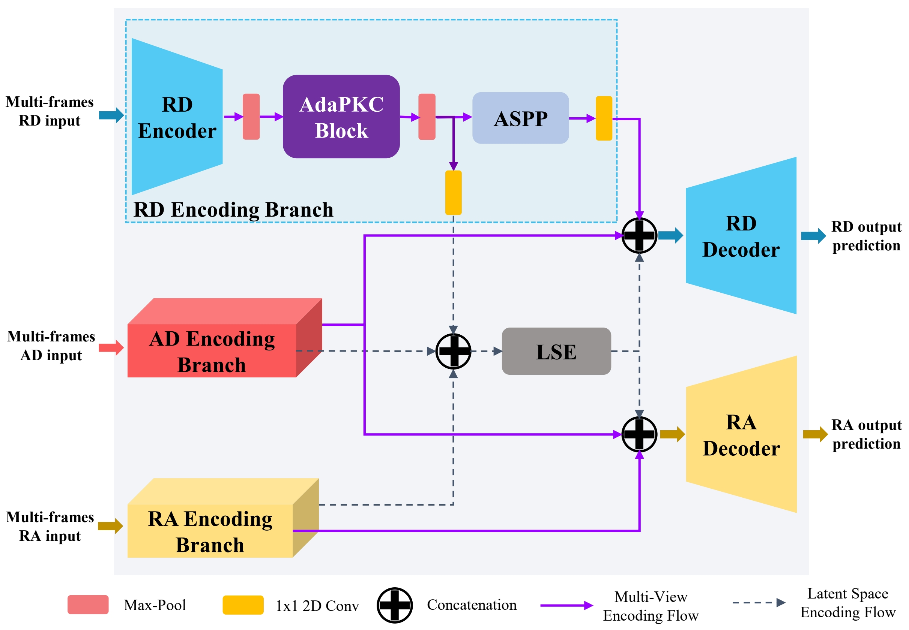
- [Metric-based AdaPKC: $	ext{AdaPKC}^
otopxi$](./images/AdaPKC/AdaPRF-xi_0_2.png) 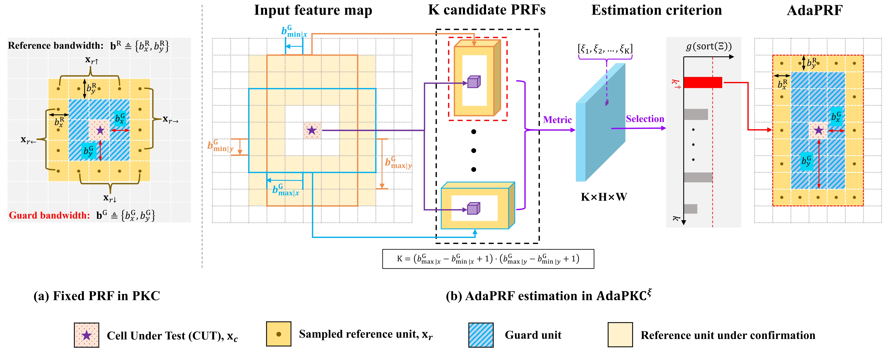
- [Learning-based AdaPKC: $	ext{AdaPKC}^	heta$](./images/AdaPKC/AdaPRF-theta_0_2.png) 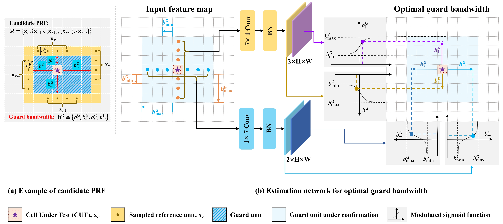


### TARSS-Net

> **TARSS-Net**: *Temporal-Aware Radar Semantic Segmentation Network*.  
> **Publication**: NeurIPS 2024.  
> **Authors**: Youcheng Zhang*, Liwen Zhang*, Zijun Hu, Pengcheng Pi, Teng Li, Yuanpei Chen, Shi Peng, Zhe Ma.  [*Equal contribution]

- [TARSS-Net Principle](./images/tarss-principle.png "TARSS-Net Principle") 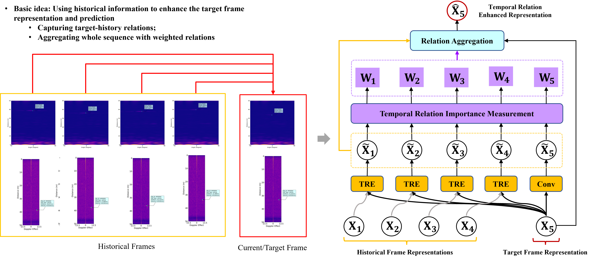
- [Basic Mechanism](./images/mechanism.png) 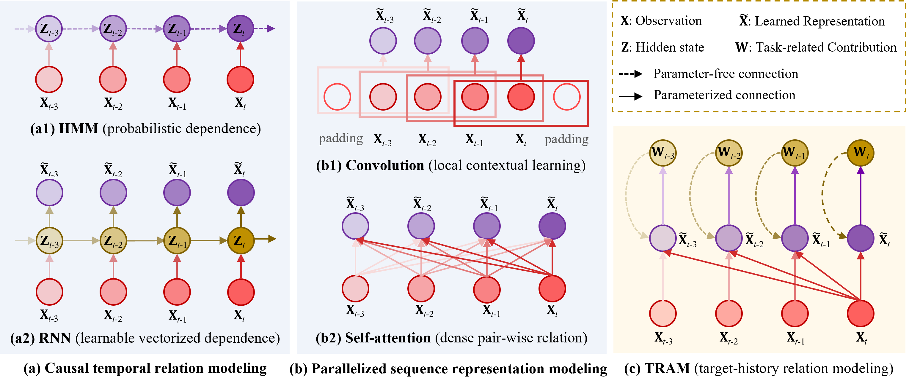
- [TARSS-Net Architecture](./images/tarss-net-teaser.png "TARSS-Net") 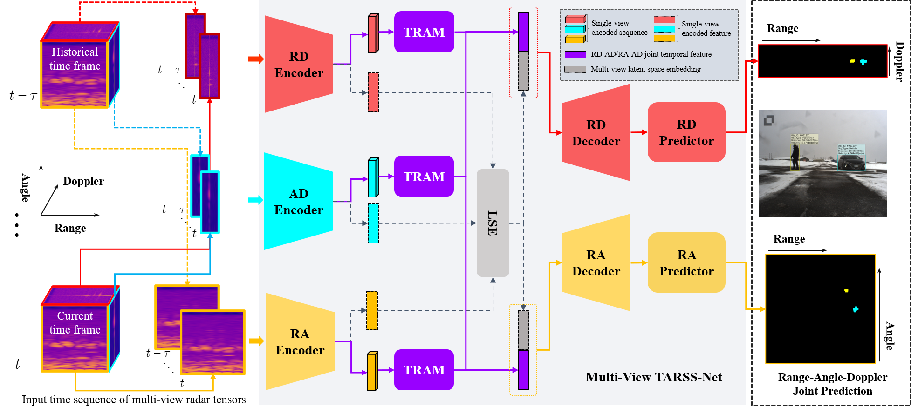
- [Key Component: TRAP](./images/trap.png) 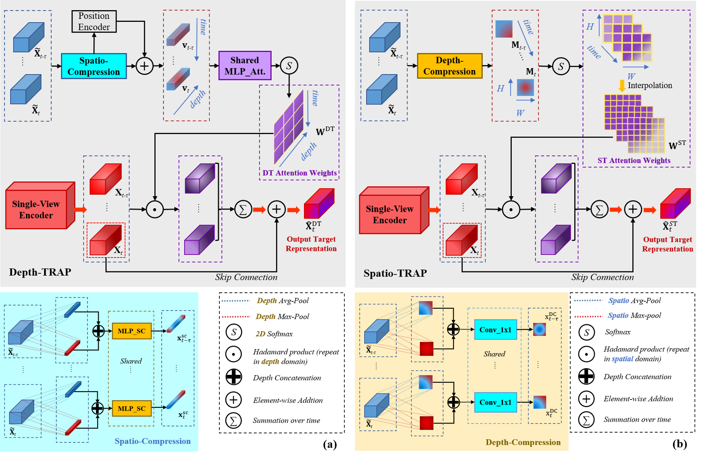

### AXFL-Net

> **AXFL**: *Axial prior-guided cross-view fusion learning for radar semantic segmentation*.  
> **Publication**: *Expert Systems with Applications*, 303 (2025): 130552.  
> **Authors**: Teng Li, Liwen Zhang*, Youcheng Zhang, Qingmin Liao.  
> [*Project lead.]

- [AXFL-Net Architecture](./images/AXFL/AXFL-Net_0.png) 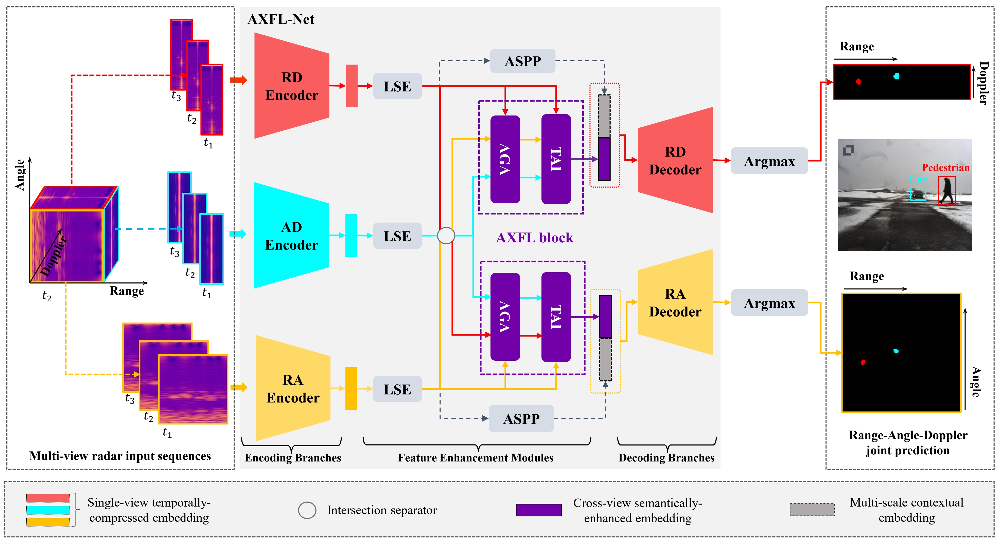
- [AXFL Projection Mechanism](./images/AXFL/Projection-and-Disperse_0.png) 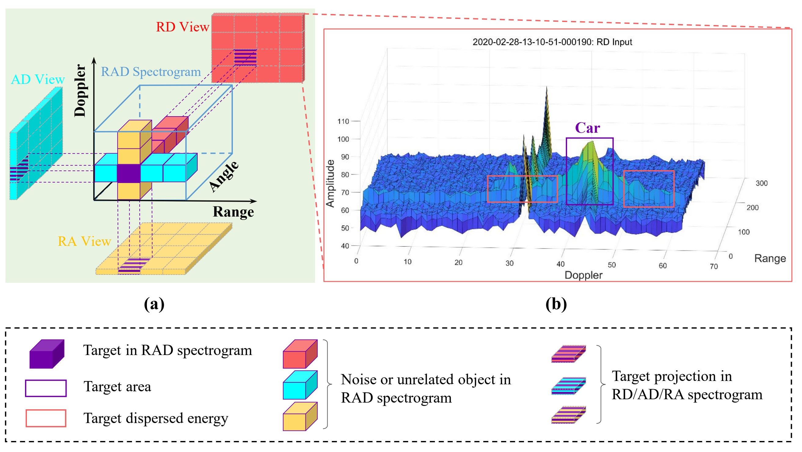

---

## 📊 Illustrations of Radar Datasets

### KuRALS: A single view RSS Benchmark

> **KuRALS**: *Ku-Band Radar Datasets for Multi-Scene Long-Range Surveillance*.  
> **Publication**: *Remote Sensing*.  
> **Authors**: Teng Li, Qingmin Liao, Youcheng Zhang, Xinyan Zhang, Zongqing Lu, Liwen Zhang*.  
> [*Corresponding author and project lead.]

KuRALS contains two sub-datasets:
- **KuRALS-CWR**: Continuous wave radar data, RD-view only
- **KuRALS-PDR**: Pulsed Doppler radar data, RA/RD dual-view 

- [KuRALS Data Samples](./images/KuRALS/data-samples_0.png "KuRALS Data") 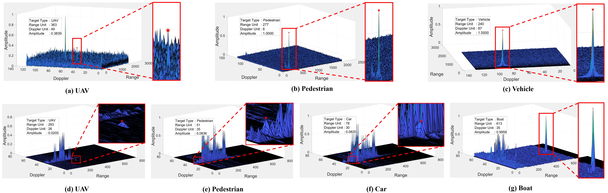
- [KuRALS Data Scale Stat.](./images/KuRALS/dataset_distribution_0.png) 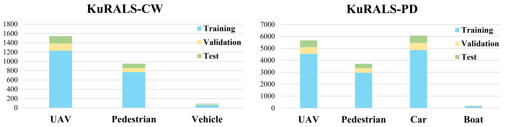
- [KuRALS Baseline](./images/KuRALS/KuRALS-Net_0_3.png) 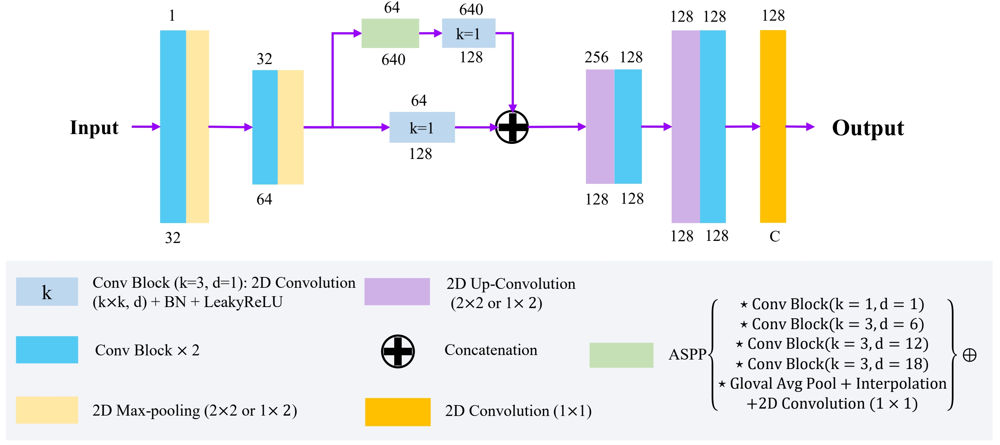

### CARRADA-RAC vs. CARRADA

> **CARRADA-RAC**: A corrected annotation pipeline and re-annotated version of the CARRADA dataset.  
> [[CARRADA-RAC Code]](https://github.com/zlw9161/CARRADA-RAC) | [[CARRADA Dataset]](https://github.com/valeoai/carrada_dataset)

- [CARRADA-RAC Vis.](./images/carrada-rac-vis.png "CARRADA-RAC Vis.") 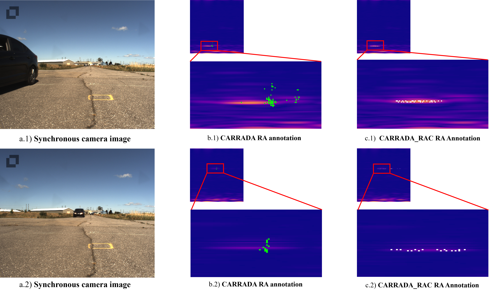 
- [CARRADA-RAC Pipeline](./images/carrada-rac-pipeline.png "CARRADA-RAC Pipeline") 

---

## 🗂️ Model Data Support

### Single-View RSS (`svrss`)

| Dataset | Model | Description | Task Type |
|:--------|:------|:------------|:----------|
| **KuRALS-CWR** | CWRNet | Default baseline model | sv (RD only) |
| | KuRadNet | Default baseline model | sv (RD only) |
| | PKCIn4CWR | PKCIn ReDA version | sv (RD only) |
| | PKCIn4CWR_Dns | PKCIn Vanilla version | sv (RD only) |
| | TARSS4CWR_V1 | TARSS-Net w/ Depth-TRAP | sv (RD only) |
| | TARSS4CWR_V2 | TARSS-Net w/ Spatio-TRAP | sv (RD only) |
| | UNet | U-Net baseline | sv (RD only) |
| | FCN8s | FCN-8s baseline | sv (RD only) |
| | DeepLabV3Plus | DeepLabV3+ w/ ResNet101 | sv (RD only) |
| | AdaPKC | To be merged | sv (RD only) |
| | TFoc | To be merged | sv (RD only) |
| **KuRALS-PDR** | BaseLine3D | Baseline w/ 3D Conv | sv (RA/RD) |
| | PKCIn4PDR | PKCIn ReDA for PDR | sv (RD only) |
| | PKCIn4PDR_Dns | PKCIn Vanilla for PDR | sv (RD only) |
| | TARSSNet_V1_RD | TARSS-Net w/ Depth-TRAP | sv (RD only) |
| | TARSSNet_V1_RA | TARSS-Net w/ Depth-TRAP | sv (RA only) |
| | TARSSNet_V2_RD | TARSS-Net w/ Spatio-TRAP | sv (RD only) |
| | TARSSNet_V2_RA | TARSS-Net w/ Spatio-TRAP | sv (RA only) |
| | AdaPKC | To be merged | sv (RD/RA) |
| | TFoc | To be merged | sv (RD/RA) |
| **CARRADA** | BaseLine3D | Baseline w/ 3D Conv | sv (RA/RD) |
| **CARRADA-RAC** | TARSSNet_V1_RD | TARSS-Net w/ Depth-TRAP | sv (RD only) |
| | TARSSNet_V1_RA | TARSS-Net w/ Depth-TRAP | sv (RA only) |
| | TARSSNet_V2_RD | TARSS-Net w/ Spatio-TRAP | sv (RD only) |
| | TARSSNet_V2_RA | TARSS-Net w/ Spatio-TRAP | sv (RA only) |
| | PKCIn4Any | PKCIn for any dataset | sv (RD/RA) |
| | AdaPKC | To be merged | sv (RD/RA) |
| | TFoc | To be merged | sv (RD/RA) |
| **NuaaSim** | EchMo / rEchMo | Echo-in mask-out segmentation for synthetic RD data | sv (RD only) |
| | PKCIn4Any_cuda | Generic PKCIn baseline for single-view RD segmentation | sv (RD only) |
| **LSFJamming** | EchMo / rEchMo | Jamming-aware RD segmentation (7 classes) | sv (RD only) |
| | PKCIn4Any_cuda | Generic PKCIn baseline for LSFJamming RD segmentation | sv (RD only) |

### Multi-View RSS (`mvrss`)

| Dataset | Model | Description | Task Type |
|:--------|:------|:------------|:----------|
| **CARRADA** | MVNet | Multi-view baseline | mv |
| **CARRADA-RAC** | MVANet | Multi-view attention network | mv |
| | MVA-DCN | MVANet w/ deformable conv | mv |
| | TMVANet | Temporal MVANet | mv |
| | TMVA-DCN | Temporal MVANet w/ DCN | mv |
| | TMVA-TDC | Temporal MVANet w/ TDC | mv |
| | TMVA-AdaPKC | Temporal MVANet w/ AdaPKC | mv |
| | PKCIn | PeakConv for multi-view | mv |
| | PKCOn | PeakConvOn for multi-view | mv |
| | AdaPKC | Adaptive PeakConv | mv |
| | ViT / ViT-RA / ViT-RD | Vision Transformer variants | mv |

---

## 🏆 Benchmark Results

### CARRADA Dataset

<details open>
<summary><b>Multi-View RSS Performance (RD & RA Views)</b></summary>

| Method | #Params | Frames | RD mIoU ↑ | RD mDice ↑ | RA mIoU ↑ | RA mDice ↑ | Global mIoU ↑ |
|:-------|:-------:|:------:|:---------:|:----------:|:---------:|:----------:|:-------------:|
| **FCN** | 134.3M | 3 | 40.9% | 54.7% | 32.1% | 38.2% | 36.5% |
| **U-Net** | 17.3M | 3 | 38.2% | 55.4% | 30.5% | 37.8% | 34.4% |
| **DeepLabv3+** | 59.3M | 3 | 38.3% | 50.8% | 32.7% | 38.3% | 35.5% |
| **RSS-Net** | 10.1M | 3 | 32.1% | 36.9% | 32.1% | 37.8% | 32.1% |
| **RAMP-CNN** | 106.4M | 9 | 56.6% | 68.5% | 27.9% | 30.5% | 42.3% |
| **TMVA-Net** | 5.6M | 5 | 56.1% | 68.0% | 37.7% | 46.2% | 46.9% |
| **TransRadar** | 4.9M | 5 | 57.2% | 69.1% | 39.9% | 49.5% | 48.6% |
| **PKCIn-Net** | 6.3M | 5 | 60.7% | 72.6% | 43.1% | 53.7% | 51.9% |
| **AdaPKCξ-Net** | 6.3M | 5 | 61.2% | 73.1% | 44.1% | 55.1% | 52.7% |
| **AdaPKCθ-Net** | 6.3M | 5 | 61.5% | 73.6% | 43.6% | 54.5% | 52.6% |
| **AdaPKCξ-Net<sup>FiT</sup>** | 6.3M | 5 | **62.1%** | **74.0%** | 44.3% | 55.5% | **53.2%** |
| **TARSS-Net_S** | 6.2M | 5 | 68.5% | 73.8% | 43.0% | 51.2% | 55.8% |
| **TARSS-Net_D** | 6.3M | 5 | **69.1%** | **75.2%** | 43.1% | 52.4% | **56.1%** |
| **AXFL-Net** | - | 5 | **69.1%** | **75.2%** | **46.2%** | **58.7%** | **57.7%** |

> 📌 **Note:** Bold values indicate best and second-best results. Global mIoU = average of RD and RA mIoU.

</details>

### CARRADA-RAC Dataset

<details open>
<summary><b>Multi-View RSS Performance (RD & RA Views)</b></summary>

| Method | #Params | Frames | RD mIoU ↑ | RD mDice ↑ | RA mIoU ↑ | RA mDice ↑ | Global mIoU ↑ |
|:-------|:-------:|:------:|:---------:|:----------:|:---------:|:----------:|:-------------:|
| **MVA-Net** | 4.8M | 3 | 53.5% | 65.3% | 37.1% | 44.8% | 45.3% |
| **TMVA-Net** | 5.6M | 5 | 59.7% | 69.9% | 46.6% | 57.9% | 53.2% |
| **PKCOn** | 5.7M | 1 | 59.1% | 71.0% | 46.8% | 58.1% | 53.0% |
| **PKCOn*** | 5.7M | 1 | 59.9% | 71.8% | 46.5% | 57.9% | 53.2% |
| **PKCIn** | 6.3M | 5 | 60.3% | 72.0% | 48.4% | 60.1% | 54.4% |
| **PKCIn*** | 6.3M | 5 | 61.0% | 72.9% | 48.6% | 60.3% | 54.8% |
| **PKCIn-Net** | 6.3M | 5 | 60.6% | 72.4% | 47.3% | 58.7% | 54.0% |
| **AdaPKCξ-Net** | 6.3M | 5 | 61.6% | 73.6% | 47.9% | 59.3% | 54.8% |
| **AdaPKCθ-Net** | 6.3M | 5 | 60.7% | 72.7% | 48.1% | 59.6% | 54.4% |
| **AdaPKCξ-Net<sup>FiT</sup>** | 6.3M | 5 | 60.8% | 72.7% | **48.8%** | **60.5%** | 54.8% |
| **TARSS-Net_S** | 6.2M | 5 | 62.5% | 74.3% | 45.8% | 56.1% | 54.2% |
| **TARSS-Net_D** | 6.3M | 5 | **62.8%** | **74.6%** | 47.4% | 58.7% | **55.1%** |
| **AXFL-Net** | - | 5 | **63.5%** | **75.8%** | **48.9%** | **61.2%** | **56.2%** |

> 📌 **Note:** * indicates ReDA-PKC variant. CARRADA-RAC provides improved RA annotations for more accurate evaluation.

</details>

### KuRALS Dataset

<details open>
<summary><b>Single-View RSS Performance (RD View)</b></summary>

| Method | #Params | Frames | mIoU ↑ | mDice ↑ |
|:-------|:-------:|:------:|:------:|:-------:|
| **FCN** | 134.3M | 5 | 50.4% | 59.4% |
| **U-Net** | 17.3M | 5 | 52.4% | 60.1% |
| **DeepLabv3+** | 59.3M | 5 | 52.6% | 61.8% |
| **TMVA-Net<sub>sv</sub>** | 5.6M | 5 | 52.9% | 63.1% |
| **KuRALS-Net** | 1.2M | 5 | 56.0% | 65.5% |
| **KuRALS-Net w/ PKC** | 1.2M | 5 | 56.7% | 65.9% |
| **PKCIn-Net<sub>sv</sub>** | 1.2M | 5 | 56.7% | 65.9% |
| **TARSS-Net_S<sub>sv</sub>** | 1.2M | 5 | 53.2% | 63.8% |
| **TARSS-Net_D<sub>sv</sub>** | 1.3M | 5 | 58.4% | 67.1% |
| **KuRALS-Net w/ AdaPKCξ** | 1.2M | 5 | 57.3% | 67.2% |
| **KuRALS-Net w/ AdaPKCθ** | 1.2M | 5 | 57.8% | 67.6% |
| **KuRALS-Net w/ AdaPKCξ<sup>FiT</sup>** | 1.2M | 5 | **58.2%** | **67.6%** |

> 📌 **Note:** <sub>sv</sub> denotes single-view version adapted from multi-view models.

</details>

---

## 💻 Installation

Please first clone or download the repo from [[PeCoRSS]](https://github.com/zlw9166/PeCoLab/tree/main).

> *PeCoRSS is part of the PeCoLab perception library, focused on radar semantic segmentation.*

### Step 1 — Install base library

```bash
cd PeCoRSS
pip install -e .
```

### Step 2 — Install dependencies

```bash
pip install scikit-image scikit-learn scipy
pip install tensorboard
```

### Step 3 — Optional CUDA Extension for PeakConv Acceleration

> This step is optional. It is only required for CUDA-accelerated PKC-based models.

```bash
cd PeCoRSS
python setup.py develop --with-cuda
```

If you do not install cuda toolkit, you should download `cuda_12.3.0_545.23.06_linux.run` (this is the recommended cuda version, please check your GPU-CUDA support, e.g., using `nvidia-smi` to check the supported CUDA version). The following instruction is the introduction of installing `cuda_XX.run`:

```bash
$ cd your_path_to_downloaded_cuda_file
$ sudo ./cuda_12.3.0_545_23.06_linux.run
```

Please enter `space` to avoid installing driver again, then enter `install` to run the cuda installation. When the installation complete, please typing:

```bash
$ nvcc --version
```

to verify the cuda toolkit installation, if `nvcc` is not available, please add path to `~\.bashrc`;

```bash
$ vim ~\.bashrc
```

Add `export PATH="/usr/local/cuda-12.3/bin:$PATH"` under `# >>>conda initialize >>>`. Then

```bash
$ source ~\.bashrc
$ nvcc --version
```

Then go to the step of cuda implementation of PRF gathering.

#### CUDA Acceleration Effects

| Model | GPU Mem. | GMac | FPS | Input Size | #Params |
|:------|:--------:|:----:|:---:|:----------:|:-------:|
| PKCIn4CWR | 12007 MB | 162.52 | 29.5 | 1,1,5,124,2048 | 1.21 M |
| PKCIn4CWR (accelerated) | 5697 MB | 162.52 | 63.7 | 1,1,5,124,2048 | 1.21 M |
| PKCIn4PDR | 3007 MB | 32.77 | 137.5 | 1,1,5,64,800 | 1.21 M |
| PKCIn4PDR (accelerated) | 1761 MB | 32.77 | 396.6 | 1,1,5,64,800 | 1.21 M |

---

## 🚀 Running Tutorial

### Single-View RSS (`svrss`)

#### 1. Path Setup

Check the home path first:

```bash
python svrss/utils/check_home.py
```

Set data and log paths:

```bash
cd PeCoRSS/svrss/utils/
python set_paths.py \
  --carrada /path/to/Carrada \
  --cwr /path/to/KuRALS/KuCW \
  --pdr /path/to/KuRALS/KuPD \
  --nuaasim /path/to/NuaaSim/npy \
  --lsf_jamming /path/to/LSFJamming \
  --logs /path/to/logs
```

> Paths are written to `svrss/config_files/config.ini`.

#### 2. Training

**Single GPU**
```bash
cd svrss
python run.py --cfg config_files/tarssnet_v1_rd.json
```

**DataParallel**
```bash
python run_dp.py --cfg config_files/pkcin4cwr.json
```

> Add `"gpu_id": [0,1]` to the config JSON.

**DistributedDataParallel** (Linux only)
```bash
OMP_NUM_THREADS=2 CUDA_VISIBLE_DEVICES=0,1 \
torchrun --nnodes=1 --nproc_per_node=2 --master_port=12355 \
run.py --cfg config_files/pkcin4cwr.json
```

> Or use `bash run_ddp.sh`.

#### 3. Inference / Testing

```bash
cd svrss
python infer.py --cfg /path/to/logs/datatype/exp_name/config.json
```

#### 4. Visualization

```bash
tensorboard --logdir=/path/to/logs/datatype/exp_name/ --port 8898
```

### Multi-View RSS (`mvrss`)

#### 1. Path Setup

```bash
cd PeCoRSS/mvrss/utils/
python set_paths.py \
  --carrada /path/to/Carrada \
  --logs /path/to/logs
```

> Paths are written to `mvrss/config_files/config.ini`.

#### 2. Training

**Single GPU**
```bash
cd mvrss
python run.py --cfg config_files/tmvanet.json
```

**DataParallel**
```bash
python run_dp.py --cfg config_files/mvanet.json
```

**DistributedDataParallel** (Linux only)
```bash
bash run_ddp.sh
```

#### 3. Inference / Testing

```bash
cd mvrss
python infer.py --cfg /path/to/logs/datatype/exp_name/config.json
```

---

## 📖 Citation

If you find PeCoRSS useful in your research, please consider citing the following papers:

### KuRALS
```bibtex
@article{li_kurals,
  title   = {KuRALS: Ku-Band Radar Datasets for Multi-Scene Long-Range Surveillance},
  author  = {Li, Teng and Liao, Qingmin and Zhang, Youcheng and Zhang, Xinyan and Lu, Zongqing and Zhang, Liwen},
  journal = {Remote Sensing},
  note    = {Liwen Zhang is the corresponding author and project lead}
}
```

### AXFL
```bibtex
@article{li2025axfl,
  title   = {AXFL: Axial prior-guided cross-view fusion learning for radar semantic segmentation},
  author  = {Li, Teng and Zhang, Liwen and Zhang, Youcheng and Liao, Qingmin},
  journal = {Expert Systems with Applications},
  volume  = {303},
  pages   = {130552},
  year    = {2025},
  note    = {Project lead}
}
```

### TARSS-Net
```bibtex
@inproceedings{zhang2024tarssnet,
  title     = {TARSS-Net: Temporal-Aware Radar Semantic Segmentation Network},
  author    = {Zhang, Youcheng and Zhang, Liwen and Hu, Zijun and Pi, Pengcheng and Li, Teng and Chen, Yuanpei and Peng, Shi and Ma, Zhe},
  booktitle = {Advances in Neural Information Processing Systems},
  year      = {2024},
  note      = {Youcheng Zhang and Liwen Zhang contributed equally; project lead}
}
```

### AdaPKC
```bibtex
@inproceedings{li2024adapkc,
  title     = {AdaPKC: PeakConv with Adaptive Peak Receptive Field for Radar Semantic Segmentation},
  author    = {Li, Teng and Zhang, Liwen and Zhang, Youcheng and Hu, Zijun and Pi, Pengcheng and Lu, Zongqing and Liao, Qingmin and Ma, Zhe},
  booktitle = {Advances in Neural Information Processing Systems},
  year      = {2024},
  note      = {Teng Li and Liwen Zhang contributed equally; project lead}
}
```

### PeakConv
```bibtex
@inproceedings{zhang2023peakconv,
  title     = {PeakConv: Learning Peak Receptive Field for Radar Semantic Segmentation},
  author    = {Zhang, Liwen and others},
  booktitle = {Proceedings of the IEEE/CVF Conference on Computer Vision and Pattern Recognition},
  year      = {2023}
}
```

---

## 🙏 Acknowledgements

- [CARRADA Dataset](https://arxiv.org/abs/2005.01456) — Multi-view radar dataset.
- [MVRSS](https://arxiv.org/abs/2103.16214) — Basic framework for multi-view RSS.

---

## 📦 Package Info

| Field | Info |
|:------|:-----|
| **Package** | `pecorss` |
| **Version** | `1.0.6` |
| **License** | Apache 2.0 |
| **Repository** | [https://github.com/zlw9161](https://github.com/zlw9161) |
| **Contact** | lwzhang9161@126.com |

---

## 📄 License

PeCoRSS is released under the [Apache 2.0 License](LICENSE).

---

## 📜 Changelog

For detailed release notes and version history, see [CHANGELOG.md](./CHANGELOG.md).

---

<div align="center">

**⭐ Star us on GitHub — it motivates us a lot!**

</div>

---

## 📝 Update Log (v1.0.6)

### LMF_V7 and Chain-Parallel Upgrade

- Added `Learnable_Match_FilterV7` in `svrss/models/echmo_debug.py` as a latency-optimized LMF implementation.
- Added `LMF_Layer_Parallel` and `LMF_Chain_Parallel` to support true chain-parallel LMF execution.
- Added configurable LMF switches in runtime (`lmf_impl`, `lmf_chain_impl`) and integrated them into EchMo/EchMoWide and `run_echmo.py`.
- Kept compatibility with the existing V6 training semantics (prior + residual mode behavior).

### Compute Report and Equivalence Updates

- Added `MLDC` vs `MLDC_Parallel` numerical equivalence section to `svrss/readme/EchMo_Backbone_Compute_Report.md`.
- Added `LMF_V6` vs `LMF_V7` vs `LMF_Chain_Parallel` equivalence and latency comparisons to the same report.
- Added standalone LMF technical report: `svrss/readme/LMF_V7_Chain_Parallel_Modification_Report.md`.

### Scale Scheme Updates (EchMo Family)

- Completed scale-scheme rollout for EchMo family variants under `svrss/config_files/`.
- Added/updated the following scale configs:
  - `echmo_itc_scale.json` (base scale)
  - `echmo_wide_itc_scale.json`
  - `echmo_deep_itc_scale.json`
  - `echmo_memo_itc_scale.json`
  - `echmo_4moe_itc_scale.json`
  - `echmo_itc_scale_lmf-v7.json`
  - `echmo_itc_scale_lmf_chain_parallel.json`
  - `echmo_itc_scale_lmf1.json`
  - `echmo_ablation_lmf_layers2_scale.json`
  - `echmo_ablation_ldc_channels4_scale.json`
- Added corresponding architecture/compute notes in `svrss/readme/` for scale variants.

### Documentation and Repo Organization

- Moved `svrss` root-level markdown technical notes into `svrss/readme/`.
- Standardized newly added technical notes to English for better public readability.
- Unified class naming in parallel LMF path (`LMF_Layer_Parallel`) to keep architecture naming concise and consistent.

### Notes

- Detailed release notes are available in [CHANGELOG.md](./CHANGELOG.md).
- Current package version is `1.0.6`.
