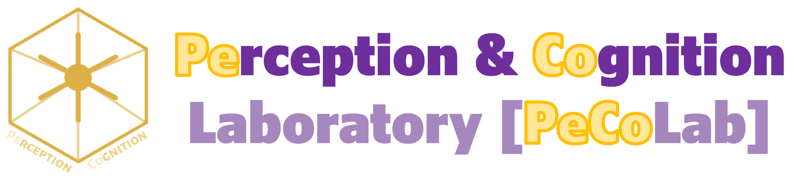
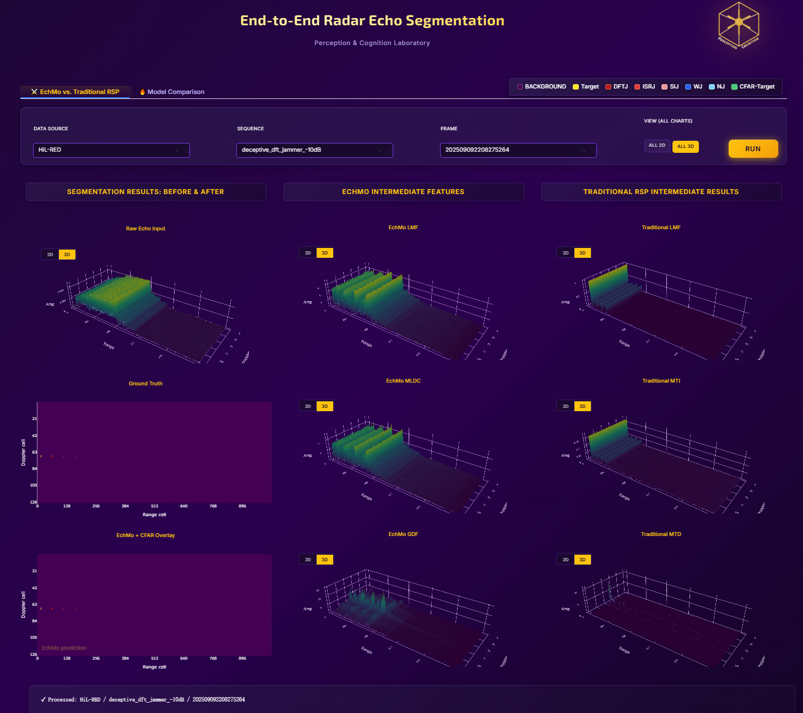
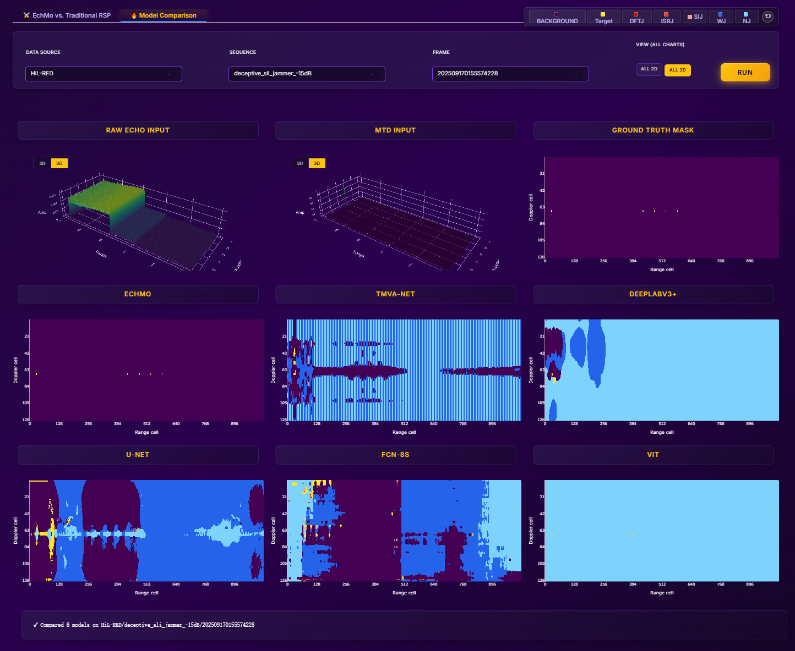

# End-to-End Radar Echo Segmentation Visualization

[](https://gradio.app/)
[](https://pytorch.org/)
[](LICENSE)

A comprehensive visualization tool for end-to-end radar echo segmentation, supporting multiple deep learning models and comparison with traditional signal processing methods.

## Overview

This project provides an interactive web interface for radar echo data segmentation using state-of-the-art deep learning models. It allows users to:

- Visualize radar echo segmentation results from multiple models
- Compare deep learning approaches with traditional signal processing (LMF, MTI, MTD, CFAR)
- Perform side-by-side model comparisons

## Screenshots

**EchMo vs. Traditional RSP** — the segmentation result (raw echo, ground truth,
EchMo + CFAR overlay) next to the EchMo intermediate features (LMF / MLDC / GDF) and the
traditional pipeline (LMF / MTI / MTD), shown for a HiL-RED deceptive-jamming sequence
with the "ALL 3D" view enabled.



**Model Comparison** — the same frame segmented by EchMo, TMVA-Net, DeepLabV3+, U-Net,
FCN-8s and ViT side by side, together with the raw echo, the MTD input and the ground truth.



## Supported Models

| Model | Description |
|-------|-------------|
| **EchMo** | End-to-end Complex-valued Hierarchical Model (proposed method) |
| **U-Net** | Classic convolutional encoder-decoder architecture |
| **DeepLabV3+** | DeepLabV3+ with ResNet-101 backbone |
| **FCN-8s** | Fully Convolutional Network with 8x upsampling |
| **TMVA-Net** | Temporal Multi-View Attention Network |
| **ViT** | Vision Transformer for semantic segmentation |

## Datasets

> **The datasets are not part of this repository.**
> This repository hosts the application code only. The **Syn-RED and HiL-RED datasets**
> (and the pre-trained weights) are distributed separately — the download link will be
> added here as soon as it is available. Everything shown below describes what the app
> expects to find in `datasets/` once you have downloaded it.

The application supports the two echo datasets introduced in the paper,
**Syn-RED** and **HiL-RED**:

### Syn-RED — Synthetic Radar Echo Dataset
Low-slow-small (LSS) target detection, built by precise electromagnetic simulation.

- Controlled target scenes with varying motion characteristics and SNRs
- Multiple distances (1000m, 3000m, 5000m)
- Motion types: Line, O-shape, S-shape (Hover scenarios exist in the raw data but are not exposed in the UI)
- SNR levels: 10 dB, 14 dB, 18 dB
- 2 annotated classes: background, target

### HiL-RED — Hardware-in-the-Loop Radar Echo Dataset
Target-jammer recognition under active electronic countermeasures, captured on a
hardware-in-the-loop platform that incorporates radar interference types and JSR.

- Jamming types: Barrage (narrow/wide), Deceptive (DFT / ISR / SLI)
- Jamming intensities: -10 dB, -15 dB, -20 dB
- 7 annotated classes (background, target, DFTJ, ISRJ, SIJ, WJ, NJ); the networks are
trained with 9 output channels

Each dataset folder carries a `dataset_meta.json` that declares dataset-specific
behaviour (MTD `fftshift`, the MTD amplitude folder, the classes offered by the UI
filter). Adding a dataset means dropping in a folder — no code change needed.
Model runs are discovered from `models/<dataset>/*/config.json` (the folder must
contain `"model": "..."` and `results/<model>.pt`). When a dataset holds several
runs of the same model the alphabetically first one wins, and
`"run_overrides": {"model": "run_folder"}` in `dataset_meta.json` pins a specific
one - useful when e.g. a 7-class and a 9-class HiL-RED checkpoint coexist.

## Features

### Single Model Tab
- Visualize intermediate features from EchMo (LMF, MLDC, GDF)
- Compare with traditional RSP methods
- Display raw echo input, ground truth, and prediction masks

### Model Comparison Tab
- Run inference with all 6 models simultaneously
- Side-by-side visualization of segmentation results
- Easy comparison of model performance

## Installation

This repository hosts the **code only**. The pre-trained weights (~2.5 GB) and the
datasets are distributed separately, because they are too large for GitHub — the download
link will be announced here.

### Step 1 — Get the models and the datasets (required)

```bash
# 1. Clone the code
git clone <repository-url>
cd echmo_gradio

# 2. Download the weights and the datasets (link to be announced) and unpack them in
#    the project root, so that the layout below appears:
#      models/<dataset>/<run_name>/config.json     # layer / hyper-parameters
#      models/<dataset>/<run_name>/results/<model>.pt
#      datasets/<dataset>/...
```

The layout the app expects:

```
<project root>/
├── app.py
├── models/<dataset>/<run_name>/config.json                        # layer/hyper-params
├── models/<dataset>/<run_name>/results/<model>.pt                 # weights
└── datasets/<dataset>/
    ├── light_dataset_frame_oriented.json                            # sequence / frame index
    ├── dataset_meta.json                                            # per-dataset behaviour
    ├── coefs/s_tx.mat                                               # transmit reference
    └── <sequence>/range_doppler_echo/<frame>.npy                    # echo data
    └── <sequence>/annotations/dense/<frame>/range_doppler.npy       # ground truth
    └── <sequence>/<mtd_amp_dir>/<frame>.npy                         # MTD amplitude (see dataset_meta.json)
```
> **Heads-up:** model runs are discovered from `models/<dataset>/*/config.json` and
> datasets from `datasets/*/light_dataset_frame_oriented.json`. When something is missing the
> app does **not** raise: the dataset simply does not appear in the data-source dropdown, or a
> model is skipped in the comparison tab with only a console warning. Other errors surface only
> on Run ("Echo data not found", "Model file not found: ...") - so make sure Step 1 actually
> produced the layout above.

### Note on the pre-trained weights (epoch-291 exports)

The weights under `models/` are a subset copy of the training artifacts kept in
`ckpts/`. Please be aware:

- For **HiL-RED**, the deeplabv3plus, unet, vit and fcn8s weights were exported
  from **epoch 291** instead of the best epoch recorded in the training logs, so
  the metrics these four models show in the app are **lower than the paper
  values**. echmo and tmva_net_sv are not affected.
- For **Syn-RED**, the vit weight is likewise a slightly non-best export
  (Δ0.007 mIoU).
- **The results reported in the paper are unaffected**: they were taken from the
  best epoch of the TensorBoard logs, which are shipped under
  `ckpts/<dataset>/<run>/boards/`.

See `ckpts/README.md` for the full run tables and how to verify.

### Step 2 — Local setup

```bash
# Install dependencies
pip install -r requirements.txt

# Run the application
python app.py
```

The application will be available at `http://localhost:8080` (override with the `PORT`
environment variable; Hugging Face Spaces sets it automatically).

### Hugging Face Spaces Deployment

1. Create a new Space on [Hugging Face](https://huggingface.co/spaces)
2. Select "Gradio" as the SDK
3. Upload the following files:
   - `app.py`
   - `requirements.txt`
   - `models/` directory (with pre-trained weights)
   - `datasets/` directory (downloaded data)
4. The Space will automatically start with `python app.py`

## File Structure

```
.
├── app.py                      # Main Gradio application
├── asset_paths.py              # single source of truth for dataset/model paths
├── requirements.txt            # Python dependencies
├── README.md                   # This file
├── logos/                      # PeCoLab banner + header logo
│   ├── logo.jpg                # app header logo (app.py: LOGO_PATH)
│   └── peco-logo-banner-yellow.png
├── models/                     # Model definitions (repo) + weights (Step 1 download)
│   ├── echmo.py
│   ├── unet.py
│   ├── deeplabv3plus.py
│   ├── fcn8s.py
│   ├── tmva_net_sv.py
│   ├── vit.py
│   ├── Syn-RED/                # config.json + results/*.pt   (Step 1)
│   └── HiL-RED/                # config.json + results/*.pt   (Step 1)
└── datasets/                   # data - downloaded separately (Step 1)
    ├── Syn-RED/
    └── HiL-RED/
```

`dataset_meta.json` declares the dataset-specific behaviour (MTD `fftshift`, the MTD
amplitude folder, the classes offered by the UI filter); `run_overrides` can pin a
specific model run when a dataset holds several of them.

## Usage

### Using Pre-loaded Datasets

1. Select a **Data Source** (Syn-RED or HiL-RED)
2. Choose a **Sequence** from the dropdown
3. Select a **Frame** to visualize
4. Click **Run** to see the results

### Model Comparison

1. Switch to the **Model Comparison** tab
2. Select data source, sequence, and frame
3. Click **Run** to compare all models side-by-side

## Input Data Format

### Transmit Signal (.mat or .npy)
- Complex-valued signal
- Shape: `(2, N)` or `(N,)` where N is signal length
- For .mat files: variable name should be `s_tx`, `st`, `transmit`, `tx_signal`, or `s`

### Echo Signal (.npy)
- Complex-valued radar echo data
- Shape: `(2, Doppler, Range)` or `(Doppler, Range)`
- Channel 0: Real part, Channel 1: Imaginary part (if 3D)

### Ground-truth Annotation (.npy)
Both layouts are accepted (see `annotation_to_label_map()` in `app.py`):

- **one-hot** `(C, Doppler, Range)`: every pixel has exactly one hot channel, the app
  applies `argmax(axis=0)`. Syn-RED uses this (`C=2`, `uint8`).
- **label map** `(Doppler, Range)`: one integer class id per pixel, used as-is.
  HiL-RED ships this form (`int8`), converted from the original 9-channel `float64`
  one-hot (~72x smaller, lossless).

HiL-RED uses class ids **0-6** only; some checkpoints were trained with 9 output
channels (the last two are always empty), which is handled automatically because
`nb_classes` is read from each run's `config.json`.

## Technical Details

### EchMo Model Architecture

The EchMo model consists of three main components:

1. **LMF (Learnable Matched Filter)** - Adaptive matched filtering
2. **MLDC (Multi-Level Deep Convolution)** - Hierarchical feature extraction
3. **GDF (Gated Doppler Fusion)** - Doppler-aware feature fusion

### Traditional Signal Processing Pipeline

1. **LMF** - Linear Matched Filtering
2. **MTI** - Moving Target Indication (clutter suppression)
3. **MTD** - Moving Target Detection (Doppler processing)
4. **CFAR** - Constant False Alarm Rate detection

## License

This project is licensed under the MIT License - see the [LICENSE](LICENSE) file for details.

## Acknowledgments

- This work was developed for radar signal processing research
- Thanks to the open-source community for PyTorch, Gradio, and other tools

## Contact

For questions or issues, please open an issue on GitHub or contact the authors.
