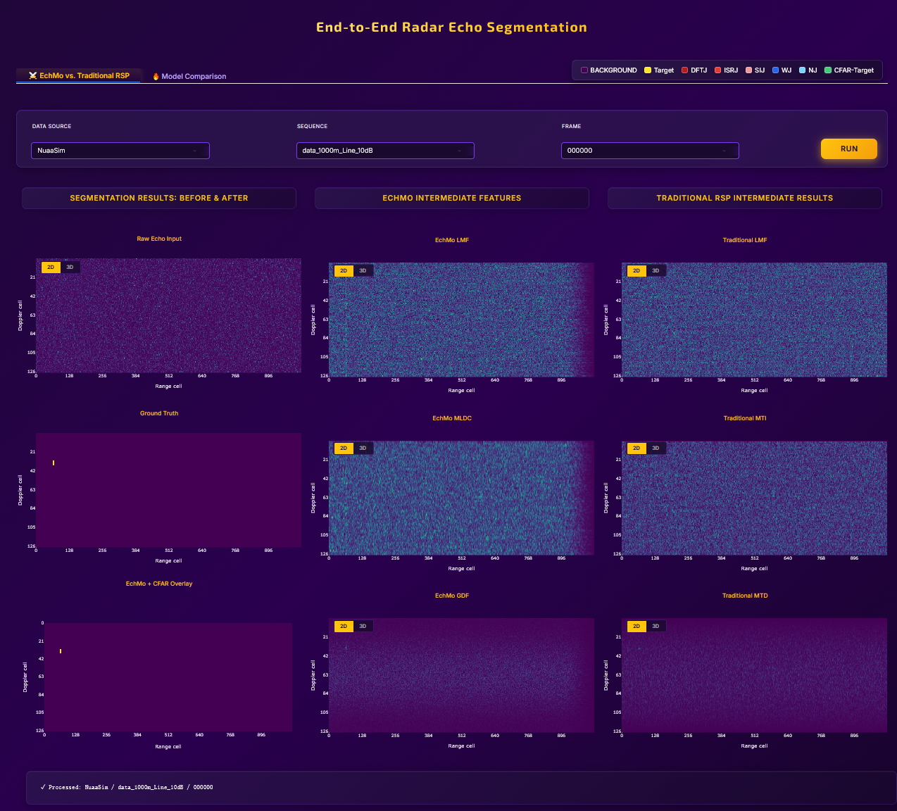
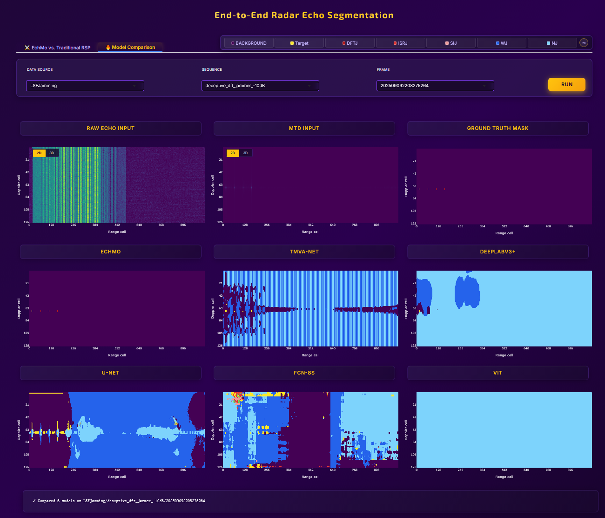

# End-to-End Radar Echo Segmentation Visualization

> **Independent visualization demo project** — An interactive Gradio application for end-to-end radar echo segmentation visualization, built on top of the `pecorss` algorithm library. It is placed within the repository but remains independently runnable.

## Overview

- **EchMo vs. Traditional RSP**: Side-by-side comparison of EchMo intermediate features (LMF / MLDC / GDF) and traditional signal processing pipeline (LMF / MTI / MTD).
- **Multi-Model Comparison**: One-click comparison of six segmentation models (EchMo, U-Net, DeepLabV3+, FCN-8s, TMVA-Net, ViT) on the same data frame.
- **2D / 3D View Toggle**: All charts support real-time switching between 2D heatmaps and 3D surface plots.
- **Class Filtering (Model Comparison Tab)**: For multi-class scenarios in the LSFJamming dataset, click the legend buttons to isolate and highlight specific jamming categories.
- **Auto-Load on Startup**: Automatically loads and renders the first frame of the default dataset upon launch.

## Screenshots

| EchMo vs. Traditional RSP | Model Comparison |
|:---:|:---:|
|  |  |

## Project Structure

When integrated into the `pecorss` repository, the files are located under `svrss/app/`:

```
svrss/app/
├── app.py                      # Gradio main entry (UI + business logic)
├── models/                     # Model definition source code (Python modules)
│   ├── echmo.py                # EchMo model
│   ├── unet.py                 # U-Net
│   ├── deeplabv3plus.py        # DeepLabV3+ (ResNet-101 backbone)
│   ├── fcn8s.py                # FCN-8s
│   ├── tmva_net_sv.py          # TMVA-Net (Single-View)
│   └── vit.py                  # Vision Transformer (ViT)
├── datasets/                   # Dataset directory (required at runtime, not tracked by Git)
│   ├── NuaaSim/
│   └── LSFJamming/
├── README.md
├── requirements.txt
└── screenshot_*.png
```

## Download

### Dataset

The `datasets/` directory currently contains **sample data only** (`HiL-RED/` and `Syn-RED/` subsets) for demonstration and quick testing. Due to the large scale of the full datasets, we are actively seeking a suitable data-hosting platform. The complete datasets will be released publicly after the paper is accepted.

### Model Weights

Pre-trained model weights are provided in the `ckpts/` folder at the repository root (e.g., `ckpts/echmo_e300_lr0.0001_ce_3/` and `ckpts/echmo_e300_lr0.0001_lsf_wce_0/`). Copy or symlink them to `svrss/app/models/` following the structure expected by `MODEL_PATHS` in `app.py`.

> **Note**: The `.pt` files in `ckpts/` are best-model snapshots and cannot be used to resume training. They are intended for inference and visualization only.

Weight folder names must match the `MODEL_PATHS` configuration in `app.py`.

## Requirements

- Python >= 3.9
- CUDA (optional, for GPU inference; CPU is also supported)

## Installation

The dependencies below are **additional** requirements on top of the core `pecorss` environment. It is recommended to install them in the same virtual environment:

```bash
cd svrss/app
pip install -r requirements.txt
```

> **Note**: `gradio>=5.0.0` is required because components such as `gr.Timer` are used.

## Launch

**Important**: `app.py` uses relative paths. You must launch it from the `svrss/app/` directory:

```bash
cd svrss/app
python app.py
```

By default, the Gradio server starts locally. The access URL will be printed in the console (usually `http://127.0.0.1:7860`).

## License

Please follow the license agreement of the main `pecorss` repository.
