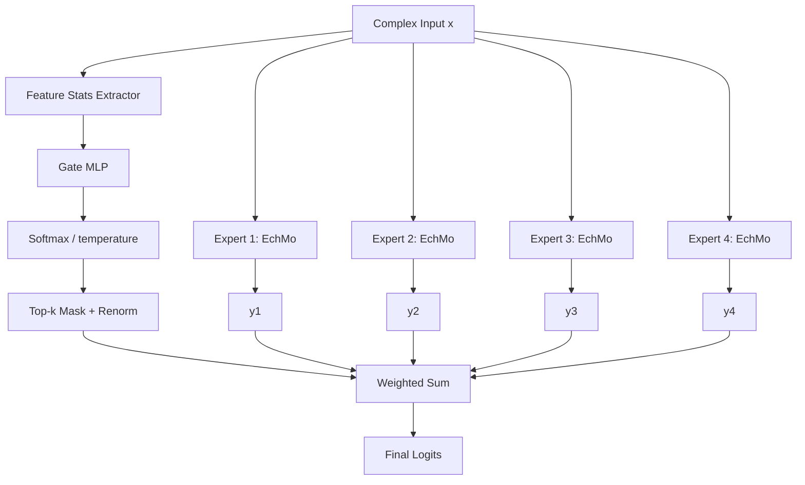

# EchMo4MoE Architecture

## 1. Core Idea

EchMo4MoE scales model capacity via expert specialization.
Each expert is a full EchMo backbone (thus preserving LMF/MLDC/GDF design), and a lightweight gate predicts per-sample expert weights.

- Experts: parallel EchMo networks.
- Gate: statistics-driven routing network.
- Fusion: top-k sparse soft weighting over expert logits.

## 2. Forward Principle

Given input $x$ and $E$ experts:

1. Expert logits:
$$
y_e = f_e(x), \quad e=1,...,E
$$

2. Gate features $g(x)$ from complex statistics:
$$
g(x) = [\mu(|x|),\;\sigma(|x|),\;\max(|x|),\;\mu(\Re x),\;\mu(\Im x),\;\sigma(\angle x)]
$$

3. Gate weights with temperature $\tau$:
$$
\mathbf{w} = \text{softmax}(\text{MLP}(g(x))/\tau)
$$

4. Top-k sparsification and renormalization:
$$
\tilde{\mathbf{w}} = \text{Renorm}(\text{TopKMask}(\mathbf{w},k) \odot \mathbf{w})
$$

5. Final fusion:
$$
y = \sum_{e=1}^{E} \tilde{w}_e\, y_e
$$

## 3. Global Architecture



## 4. Expert Internal Semantics (Unchanged)

```mermaid
flowchart LR
    I[Complex Input] --> L[LMF Chains]
    L --> M[MLDC]
    M --> G[GDF]
    G --> P[Pack |amp, phase, real, imag|]
    P --> T[Translator]
    T --> O[Logits]
```

So MoE scales at the routing layer, not by replacing physical modules.

## 5. Key Configs

- `moe_num_experts`: number of EchMo experts
- `moe_topk`: number of active experts per sample
- `moe_gate_hidden`: hidden width of gate MLP
- `moe_temperature`: routing softness temperature
- `moe_dropout`: gate dropout

## 6. Practical Notes

- Lower `moe_temperature` => sharper routing.
- `moe_topk=1` gives hard-expert tendency; `topk>1` is smoother.
- Larger expert count increases capacity but also compute (current implementation computes all experts and fuses sparsely).

## 7. Why It Scales

- Capacity grows with experts while preserving LMF/MLDC/GDF inductive design in each expert.
- Routing enables sample-dependent specialization.
- Directly compatible with current training interface and output shape.
