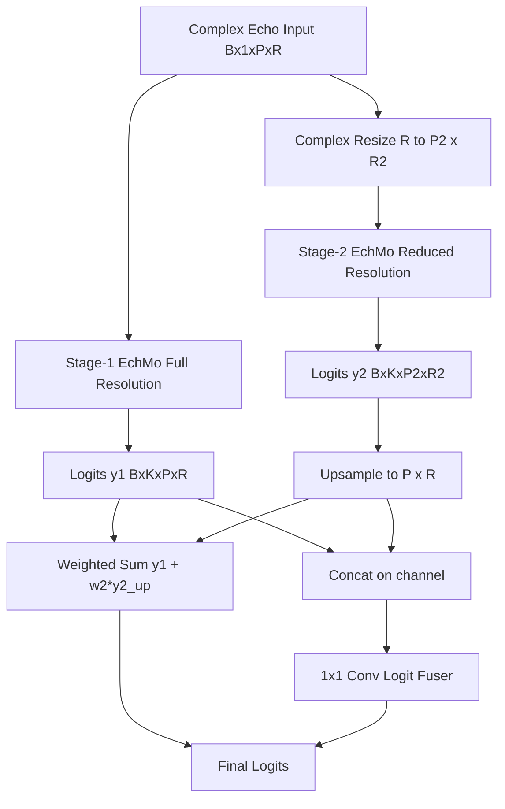

# EchMoDeep Architecture

## 1. Core Idea

EchMoDeep is a multi-resolution depth-scaling variant built on top of EchMo.
It keeps the original physical-design modules (LMF, MLDC, GDF) unchanged inside each stage,
then scales model capacity by introducing a second stage at a different resolution.

- Stage-1 (anchor branch): full resolution EchMo.
- Stage-2 (refine branch): reduced-resolution EchMo with independently scaled channels/chains.
- Output fusion: weighted sum + learnable logit fusion.

This design keeps the stage-1 branch as a stable optimization anchor while allowing stage-2
to inject complementary context at lower compute cost.

## 2. Forward Principle

Let input complex echo be $x$.

1. Stage-1 full-resolution prediction:
$$
y_1 = f_{\text{EchMo}}^{(1)}(x)
$$

2. Stage-2 reduced-resolution prediction:
$$
x_2 = \mathcal{R}(x), \quad y_2 = f_{\text{EchMo}}^{(2)}(x_2)
$$
where $\mathcal{R}(\cdot)$ is complex bilinear resize on real/imag parts.

3. Upsample stage-2 logits to stage-1 size:
$$
\tilde{y}_2 = \mathcal{U}(y_2)
$$

4. Fusion:
$$
y_{\text{sum}} = y_1 + w_2\,\tilde{y}_2
$$
$$
y_{\text{fuse}} = \text{Conv}_{1\times1}([y_1, \tilde{y}_2])
$$
$$
y = y_{\text{sum}} + y_{\text{fuse}}
$$

where $w_2$ is learnable (`stage2_weight`).

## 3. Global Architecture



## 4. Stage-wise Internal Semantics

Each stage is still a standard EchMo pipeline:

```mermaid
flowchart LR
    I[Complex Input] --> L[LMF Chains]
    L --> M[MLDC]
    M --> G[GDF]
    G --> P[Pack |amp, phase, real, imag|]
    P --> T[RD Translator]
    T --> O[Logits]
```

So EchMoDeep scales by "stacking stages at different resolutions", not by replacing
LMF/MLDC/GDF design.

## 5. Scale Controls (Config)

From `echmo_deep.py` implementation:

- `deep_stage2_enable`
  - Enable/disable second stage.

- `deep_stage2_range_scale`
  - Stage-2 range scaling factor.
  - Example: `0.5` means $R_2 = 0.5R$.

- `deep_stage2_pulse_scale`
  - Stage-2 pulse scaling factor.
  - Example: `1.0` keeps pulse length unchanged.

- `deep_stage2_chain_scale`
  - Stage-2 LMF chain count scaling.

- `deep_stage2_lmf_channel_scale`
  - Stage-2 LMF channel scaling.

- `deep_stage2_ldc_channel_scale`
  - Stage-2 MLDC channel scaling.

### Practical Notes

- If training is unstable, reduce stage-2 scales first.
- If stage-2 contribution is too weak/strong, monitor learned `stage2_weight`.
- If memory is tight, lower `deep_stage2_range_scale` and channel scales.

## 6. Why It Scales Well

- Capacity increases through an additional stage, not only larger single-stage width.
- Stage-2 works at lower resolution, giving better compute/accuracy tradeoff.
- Keeps physical module semantics intact, preserving interpretability and compatibility.
