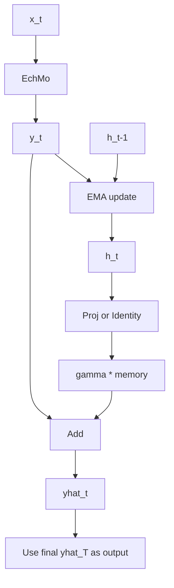

# EchMoMemo Architecture

## 1. Core Idea

EchMoMemo scales model capability along the CPI-time axis by adding a lightweight memory state on top of the original EchMo backbone.

- Backbone stays unchanged: LMF -> MLDC -> GDF -> Translator.
- Memory is maintained in logit space across CPI frames.
- Final output at each step is current logits plus memory-injected correction.

This keeps physical module semantics intact while adding temporal accumulation capacity.

## 2. Forward Principle

Given CPI sequence input $\{x_t\}_{t=1}^{T}$:

1. Backbone prediction per CPI:
$$
y_t = f_{\text{EchMo}}(x_t)
$$

2. EMA memory update:
$$
h_t = \beta h_{t-1} + (1-\beta)y_t, \quad h_1=y_1
$$

3. Memory injection:
$$
\hat{y}_t = y_t + \gamma \cdot \Phi(h_t)
$$

where:
- $\beta$ = `memo_beta` (memory retention)
- $\gamma$ = `memo_gamma` (memory contribution)
- $\Phi$ = identity or 1x1 projection (`memo_use_state_proj`)

Model returns the last-step output $\hat{y}_T$.

## 3. Global Architecture

```mermaid
flowchart LR
    A[Input sequence X = x1..xT] --> B[Frame splitter]
    B --> C1[x1]
    B --> C2[x2]
    B --> C3[...]
    B --> CT[xT]

    C1 --> E1[EchMo backbone]
    C2 --> E2[EchMo backbone]
    C3 --> E3[EchMo backbone]
    CT --> ET[EchMo backbone]

    E1 --> Y1[y1]
    E2 --> Y2[y2]
    E3 --> Y3[...]
    ET --> YT[yT]

    Y1 --> M1[h1 = y1]
    M1 --> P1[yhat1 = y1 + gamma*Proj h1]

    M1 --> M2[h2 = beta*h1 + (1-beta)*y2]
    Y2 --> M2
    M2 --> P2[yhat2 = y2 + gamma*Proj h2]

    M2 --> M3[...]
    Y3 --> M3

    M3 --> MT[hT = beta*hT-1 + (1-beta)*yT]
    YT --> MT
    MT --> PT[yhatT = yT + gamma*Proj hT]
    PT --> O[Return yhatT]
```

### 3.1 Recurrent View (Compact)



## 4. Backbone Semantics (Unchanged)

```mermaid
flowchart LR
    I[Complex Input] --> L[LMF Chains]
    L --> M[MLDC]
    M --> G[GDF]
    G --> P[Pack |amp, phase, real, imag|]
    P --> T[Translator]
    T --> O[Logits]
```

## 5. Input Shape Handling

EchMoMemo supports:
- `[B, T, P, R]`
- `[B, 1, T, P, R]`
- `[B, T, 1, P, R]`

Each CPI frame is normalized to `[B, 1, P, R]` before sending to EchMo.

## 6. Key Configs

- `memo_enable`: enable/disable memory branch
- `memo_beta`: EMA retention factor (0~1)
- `memo_gamma`: memory injection strength
- `memo_use_state_proj`: use 1x1 projection for memory state

## 7. Why It Scales

- Adds temporal capacity without changing LMF/MLDC/GDF internals.
- Cost scales roughly with CPI count while preserving module interpretability.
- Easy to ablate against single-frame EchMo by setting `memo_enable=false` or `nb_input_channels=1`.
