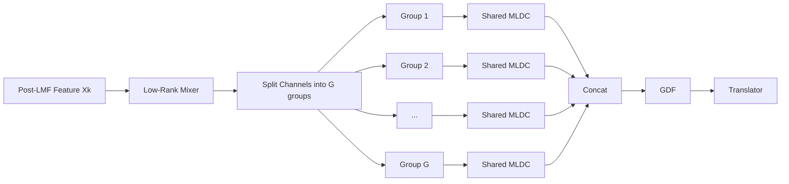
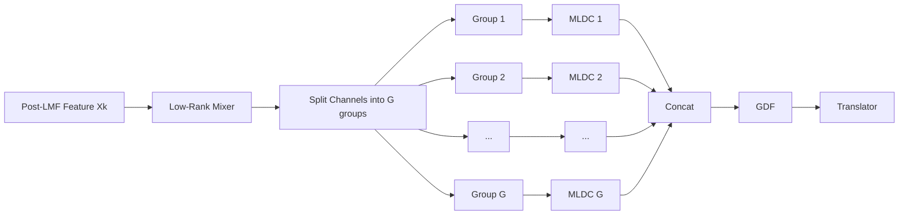

# EchMoWide Architecture

## 1. Global Overview

```mermaid
flowchart TD
    A[Complex Echo Input Bx1xPxR] --> B[LMF Chains x N]
    B --> C[Concat Channels C = lmf_chains x lmf_channels]
    C --> D[Complex Low-Rank Mixer]
    D --> E{MLDC Mode}

    E -->|Shared| F1[Split into G Groups]
    F1 --> G1[Shared MLDC applied to each group]
    G1 --> H1[Concat Group Outputs]

    E -->|Non-Shared| F2[Split into G Groups]
    F2 --> G2[MLDC Group 1]
    F2 --> G3[MLDC Group 2]
    F2 --> G4[...]
    F2 --> G5[MLDC Group G]
    G2 --> H2[Concat Group Outputs]
    G3 --> H2
    G4 --> H2
    G5 --> H2

    H1 --> I[GDF]
    H2 --> I
    I --> J[Feature Packing |amp, phase, real, imag|]
    J --> K[RD Translator]
    K --> L[Segmentation Logits]
```

## 2. Shared-MLDC Mode



### Notes
- All groups use the same MLDC weights.
- Best for parameter efficiency and regularization.
- Lower memory and fewer trainable parameters.

## 3. Non-Shared-MLDC Mode



### Notes
- Each group has its own MLDC parameters.
- Better group-specific capacity.
- Higher parameter count and training cost.

## 4. Switch Logic in Config

- shared mode: wide_share_mldc = true
- non-shared mode: wide_share_mldc = false

## 5. Paper-Style Tensor Shape View

```mermaid
flowchart TD
    A[Input complex echo\nB x 1 x P x R]
    A --> B[LMF chains x N\n(each: 1 -> C_lmf)]
    B --> C[Concat\nX_k: B x C x P x R\nC = N x C_lmf]
    C --> D[Complex Low-Rank Mixer\nrank = r]
    D --> E[Split channels into G groups\nX_k^g: B x (C/G) x P x R]

    E --> F1[MLDC per group\nout: B x (O x C_h^g) x P x R]
    F1 --> G[Concat groups\nX_h: B x (O x C_h) x P x R]

    G --> H[GDF groups = O\nout: B x O x D x R]
    H --> I[Pack features\n|X|, angle(X), Re(X), Im(X)]
    I --> J[Translator\ninput: B x (4O) x 1 x D x R]
    J --> K[Logits\nB x n_classes x D x R]
```

### Shape Notes
- $N$ = lmf_chains, $C_{lmf}$ = lmf_channels, so total LMF channels $C = N \cdot C_{lmf}$.
- $G$ = wide_groups, requires $C \bmod G = 0$ and $C_h \bmod G = 0$.
- $O$ = ldc_orders (also used as GDF group count).
- $D$ = nb_doppler.
- Shared vs non-shared MLDC only changes parameter sharing; tensor shapes are identical.
