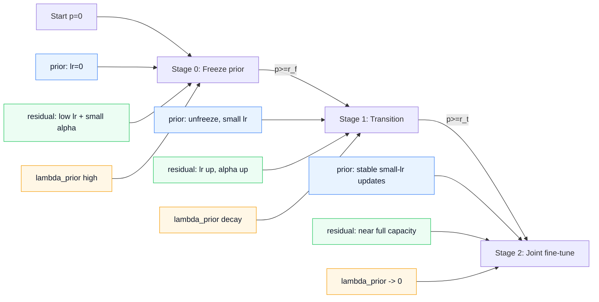

# LMF_V6 vs LMF_V5 Modification Notes

## 1. Design Motivation
LMF_V5 often shows two issues in complex scenarios:
- The prior matched-filter kernels drift too quickly, weakening the physical prior at the frontend.
- When deeper LMF blocks learn full mappings directly, early optimization can be unstable, causing background collapse or insufficient foreground recall.

Core ideas of LMF_V6:
- Keep prior filtering behavior in the first layer and control drift speed.
- Use residual learning in deeper layers, so they learn compensation terms from zero instead of relearning the full mapping.
- Introduce a staged curriculum strategy that gradually releases residual capacity and learning rate over training progress.

## 2. Architectural Changes (V5 -> V6)

### 2.1 Role Separation Between First and Deeper Layers
In LMF_V6, layer 0 runs in prior mode, and later layers run in residual mode:
- Layer 0 (prior): kernel initialized from MF coefficients and directly trained.
- Layers 1..L-1 (residual): kernel initialized to zero and trained as incremental compensation only.

Implementation mapping:
- `models/echmo_debug.py`: `Learnable_Match_FilterV6`
- `models/echmo_debug.py`: `LMF_Chain` (`residual_mode=True` when `l > 0`)

### 2.2 Residual Output Gating
V6 adds a tunable scaling factor alpha (`residual_scale` in code) to the residual branch:

$$
\mathbf{y}_{res} = \phi\left(\mathcal{F}(\mathbf{x};\Delta\mathbf{K})\right), \quad
\mathbf{y} = \mathbf{x} + \alpha \cdot \mathbf{y}_{res}
$$

Where:
- $\phi(\cdot)$ is complex activation.
- $\Delta\mathbf{K}$ is the trainable kernel in residual layers (zero-initialized).
- $\alpha$ grows from small to large according to the curriculum.

### 2.3 Prior Kernel Snapshot and Regularization
V6 stores an initialization snapshot of the prior kernel (`prior_kernel_real/imag`) in prior layers to prevent overly fast deviation from the prior.

Notation: superscript $m$ denotes the index of the $m$-th prior module (not exponentiation), and set $\mathcal{P}$ contains all prior modules.

Prior regularization:

$$
\mathcal{L}_{prior} = \sum_{m \in \mathcal{P}}\left(
\|\mathbf{K}^{(m)}_{real} - \mathbf{K}^{(m,0)}_{real}\|_2^2 +
\|\mathbf{K}^{(m)}_{imag} - \mathbf{K}^{(m,0)}_{imag}\|_2^2
\right)
$$

Total loss:

$$
\mathcal{L} = \mathcal{L}_{seg} + \lambda_{prior}(t)\,\mathcal{L}_{prior}
$$

Here $\lambda_{prior}(t)$ changes with training stage.

## 3. Training Strategy (LMF_V6 Curriculum)
Curriculum logic is implemented in [learners/model.py](learners/model.py) with:
- `_setup_lmf_v6_curriculum`
- `_build_lmf_v6_optimizer`
- `_apply_lmf_v6_curriculum`
- `_compute_lmf_prior_penalty`

### 3.1 Parameter Group Optimization
Parameters are split into 3 groups:
- `base`: all network parameters except LMF_V6, with learning rate $\eta$.
- `lmf_prior`: prior-layer parameters in V6, with learning rate $\eta\cdot s_{prior}$.
- `lmf_residual`: residual-layer parameters in V6, with learning rate $\eta\cdot s_{res}(t)$.

Note: to avoid DDP graph inconsistency, freezing is not done by dynamically toggling `requires_grad`; instead, prior groups are frozen by setting their LR to 0.

### 3.2 Three-Stage Scheduling (By Training Progress)
Let total epochs be $E$, current epoch be $e$, and normalized progress be:

$$
p = \frac{e}{E-1}
$$

Define:
- $r_f$ = `lmf_v6_freeze_ratio`
- $r_t$ = `lmf_v6_transition_ratio`, with $r_t \ge r_f$

#### Stage 0: Freeze Stage ($p < r_f$)
- Prior LR scale: $s_{prior}=0$
- Prior regularization: $\lambda_{prior}=\lambda_{start}$
- Residual gate: $\alpha=\alpha_{start}$
- Residual LR scale: $s_{res}=s_{res,start}$

#### Stage 1: Transition Stage ($r_f \le p < r_t$)
Let

$$
	au_1 = \frac{p-r_f}{r_t-r_f}
$$

Then:

$$
\lambda_{prior}=\lambda_{start}+\tau_1(\lambda_{end}-\lambda_{start})
$$

$$
\alpha=\alpha_{start}+\tau_1(0.5-\alpha_{start})
$$

$$
s_{res}=s_{res,start}+\tau_1(0.7-s_{res,start})
$$

Prior is unfrozen in this stage, with fixed scale $s_{prior}=\text{lmf_v6_prior_lr_scale}$.

#### Stage 2: Joint Fine-Tuning Stage ($p \ge r_t$)
Let

$$
	au_2 = \frac{p-r_t}{1-r_t}
$$

Then:

$$
\lambda_{prior}=\lambda_{end}(1-\tau_2)
$$

$$
\alpha=0.5+\tau_2(\alpha_{end}-0.5)
$$

$$
s_{res}=0.7+\tau_2(s_{res,end}-0.7)
$$

Prior LR scale stays fixed at $s_{prior}=\text{lmf_v6_prior_lr_scale}$.

### 3.3 Full-Cycle Strategy Overview (Prior vs Residual)

#### Stage Table (Complete Training Cycle)
| Training Stage | Progress Range | Prior Param Group | Residual Param Group | Prior Regularization $\lambda_{prior}$ | Residual Gate $\alpha$ |
|---|---|---|---|---|---|
| Stage 0 Freeze | $0 \le p < r_f$ | Frozen ($s_{prior}=0$, LR=0) | Low-speed learning ($s_{res}=s_{res,start}$) | Strong constraint ($\lambda_{start}$) | Small gate ($\alpha_{start}$) |
| Stage 1 Transition | $r_f \le p < r_t$ | Unfrozen ($s_{prior}=\text{prior\_lr\_scale}$) | Gradually accelerated ($s_{res}: s_{res,start}\to0.7$) | Linear decay ($\lambda_{start}\to\lambda_{end}$) | Linear increase ($\alpha_{start}\to0.5$) |
| Stage 2 Fine-Tune | $r_t \le p \le 1$ | Stable small-step updates (fixed $s_{prior}$) | Further acceleration ($s_{res}:0.7\to s_{res,end}$) | Continued decay ($\lambda_{end}\to0$) | Continued increase ($0.5\to\alpha_{end}$) |

> Note: when `lmf_layers=1`, only the prior module exists. The residual column becomes inactive/no-module, while prior freeze/unfreeze and regularization scheduling still apply in full.

#### Flow Diagram (Full Cycle)

## 4. New Hyperparameters: Meaning and Effect
The following parameters are from [config_files/echmo_itc_scale.json](config_files/echmo_itc_scale.json):

- `lmf_v6_curriculum_enable`
  - Meaning: whether to enable V6 curriculum training.
  - Effect: if disabled, training falls back to standard single-LR optimization.

- `lmf_v6_freeze_ratio` ($r_f$)
  - Meaning: fraction of early training used to freeze prior.
  - Effect: protects prior kernels from early gradient noise and prevents quick destruction of MF initialization.

- `lmf_v6_transition_ratio` ($r_t$)
  - Meaning: end point of transition stage.
  - Effect: controls when training moves from conservative learning to joint fine-tuning.

- `lmf_v6_prior_reg_start` / `lmf_v6_prior_reg_end` ($\lambda_{start},\lambda_{end}$)
  - Meaning: start/end weights of prior regularization.
  - Effect: strong prior constraint early, then gradual relaxation to improve task adaptation.

- `lmf_v6_prior_lr_scale`
  - Meaning: LR scale $s_{prior}$ for prior parameter group.
  - Effect: keeps prior updates small even after unfreezing, balancing prior preservation and adaptability.

- `lmf_v6_residual_lr_scale_start` / `lmf_v6_residual_lr_scale_end`
  - Meaning: start/end LR scales for residual parameter group.
  - Effect: moves residual learning from conservative to full-strength, reducing early divergence risk.

- `lmf_v6_residual_alpha_start` / `lmf_v6_residual_alpha_end`
  - Meaning: start/end values of residual gate alpha.
  - Effect: first weakens residual perturbation to backbone outputs, then progressively increases residual expressiveness.

### 4.1 Current Experiment Values (`echmo_itc_scale`)
- `lmf_v6_curriculum_enable = true`
- `lmf_v6_freeze_ratio = 0.1`
- `lmf_v6_transition_ratio = 0.5`
- `lmf_v6_prior_reg_start = 0.01`
- `lmf_v6_prior_reg_end = 0.0001`
- `lmf_v6_prior_lr_scale = 0.1`
- `lmf_v6_residual_lr_scale_start = 0.3`
- `lmf_v6_residual_lr_scale_end = 1.0`
- `lmf_v6_residual_alpha_start = 0.1`
- `lmf_v6_residual_alpha_end = 1.0`

## 5. Key Differences from V5
- Parameterization:
  - V5: each layer directly learns a full filter kernel.
  - V6: role-separated structure with prior in first layer and residual in deeper layers.

- Initialization:
  - V5: unified MF initialization.
  - V6: prior uses MF, residual uses zero initialization.

- Forward form:
  - V5: $y=\phi(\mathcal{F}(x;K))$
  - V6 residual: $y=x+\alpha\,\phi(\mathcal{F}(x;\Delta K))$

- Training constraint:
  - V5: no prior-anchoring regularization.
  - V6: adds $\mathcal{L}_{prior}$ with staged LR/gate scheduling.

## 6. Practical Suggestions
- If foreground recall is low:
  - Slightly increase `lmf_v6_residual_alpha_end` or `residual_lr_scale_end`.
- If early training is unstable:
  - Increase `freeze_ratio`, or increase `prior_reg_start`.
- If late-stage model is underfitting:
  - Decrease `prior_reg_end`, or move `transition_ratio` earlier.

The central goal of this strategy is to preserve physical-prior stability while progressively releasing residual branch adaptation capacity.
